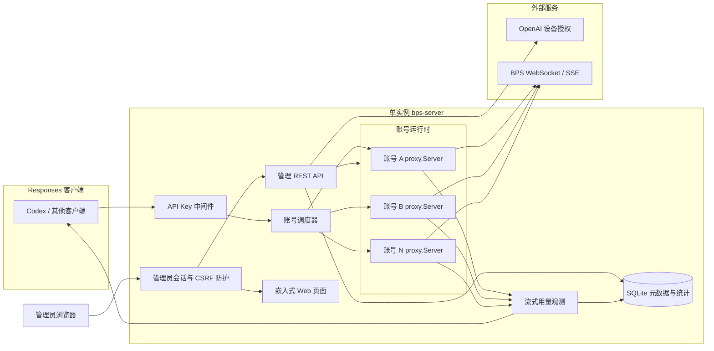

# Web 管理与多账号网关实施方案

> 状态：已实施（2026-11-10 完成开发与本地验证；真实账号授权验证经确认跳过）  
> 编写日期：2026-11-09  
> 适用代码：当前 `bps-local-public` 独立 CLI 源码  
> 实施目标：在保留现有单账号 CLI 行为的前提下，增加简单 Web 管理页面、多账号授权与调度、API Key 管理、用量统计和 Docker Compose 部署。  
> 实施入口：`cmd/bps-server`；使用说明见 [WEB-MANAGEMENT.md](WEB-MANAGEMENT.md)；UI 自动化测试：`python scripts/ui-test.py`（需先安装 Python Playwright 与 Chromium）。

## 1. 方案摘要

新增一个独立的管理版入口 `cmd/bps-server`，复用现有 `internal/proxy`、`internal/auth` 和 `internal/basispoints`，不重写 BPS 协议转换逻辑。

管理版由两个 HTTP 监听端口组成：

- **API 端口**：默认 `8790`，向 Responses 客户端提供服务，必须使用 API Key。
- **管理端口**：默认 `8791`，提供 Web 页面和管理 API，使用独立管理员登录会话。

每个 BPS 账号拥有独立的 `proxy.Server`、`auth.Store`、HTTP Transport 和工具回放缓存。顶层网关只负责 API Key 校验、账号选择、请求转发和用量记录，从而尽量降低对现有代码的侵入。

首版采用：

- Go 嵌入式静态 Web 页面，无 Node.js 构建链、无 CDN 依赖。
- SQLite 保存账号元数据、API Key 哈希和请求统计。
- 现有 OAuth 文件保存 Access Token 等凭据，数据库不保存 Token 明文。
- 加权最少在途请求调度，辅以可选会话软粘性和失败冷却。
- 单实例 Docker Compose 部署，命名卷持久化 `/data`。

## 2. 边界与前提

### 2.1 当前代码事实

现有实现具有以下约束：

1. `cmd/bps-local/main.go` 一次只加载一个 OAuth 文件。
2. `internal/proxy/proxy.go` 只提供 Responses 和 `healthz` 路由，没有客户端 API Key 校验。
3. `proxy.Server.Handler()` 已可作为 `http.Handler` 复用，不必让每个账号占用一个监听端口。
4. `auth.DeviceClient.Login()` 已实现设备授权和最多 15 分钟轮询，可在后台授权任务中复用。
5. `auth.SaveDeviceCredentials()` 能以不覆盖已有文件的方式保存新凭据。
6. 当前 CLI 不自动使用 Refresh Token；本方案首版继续保持这一行为。
7. 当前流式转换代码没有用量统计输出，需要新增对终端 SSE 事件的观测。
8. 当前服务强制回环监听。管理版在容器内需要监听 `0.0.0.0`，但不能因此放宽原独立 CLI 的安全限制。

### 2.2 首版范围

首版必须完成：

- 多账号新增、设备授权、重新授权、启用和禁用。
- 账号状态、在途请求数、最近错误和基础用量展示。
- API Key 创建、一次性显示、启用、禁用和撤销。
- 请求数、成功数、失败数、Token 用量和延迟统计。
- 按账号、API Key、模型和日期筛选统计。
- SQLite 持久化、数据库迁移和数据目录备份说明。
- Dockerfile、Docker Compose 和容器持久化。
- 单元测试、集成测试、构建验证和验收记录。

### 2.3 明确不在首版范围内

以下功能避免与首版同时扩张：

- 多副本高可用、分布式调度和 Redis/PostgreSQL 集群。
- 自动刷新 OAuth Token。
- 自动探测模型列表或按模型能力路由。
- 自动切换正在流式输出的请求。
- 请求内容、提示词、工具参数和响应正文审计。
- 多管理员、角色权限、组织租户和 SSO。
- 每账号独立代理配置、配额购买和计费。
- Excel 工作簿操作或上游托管工具支持。

### 2.4 设计假设

- 管理版只运行一个副本，SQLite 和内存调度状态不跨进程共享。
- 首版所有账号共用一个上游代理配置，与当前 `--proxy` 行为一致。
- 客户端仍负责发送完整历史，不启用 `previous_response_id`。
- 上游未返回 Token 用量时，统计字段保存为 `NULL`，不按零处理，也不在首版估算。
- 真实 BPS 验证会产生请求用量，必须使用已授权账号单独执行，不能混入普通 CI。

## 3. 总体架构



### 3.1 关键设计决策

| 决策 | 方案 | 原因 |
|---|---|---|
| 保留旧 CLI | 新增 `cmd/bps-server` | 避免管理功能改变现有命令的启动和监听行为 |
| 账号运行时 | 每账号一个 `proxy.Server` | 天然隔离凭据、Transport 和工具回放缓存 |
| 管理页面 | `go:embed` 嵌入原生 HTML/CSS/JS | 降低构建和部署复杂度 |
| 数据库 | SQLite WAL | 支持统计查询，且无需额外数据库容器 |
| 凭据存储 | 每账号独立 OAuth JSON | 复用现有安全加载和定期重载机制 |
| 负载均衡 | 加权最少在途请求 | 比单纯轮询更适合持续时间不同的流式请求 |
| 失败切换 | 不在首版自动重发 | 防止重复生成、重复工具调用和额外用量 |
| 用量采集 | 观测发往客户端的 SSE | 统计实际交付事件，不修改 BPS 协议转换结果 |
| 容器副本 | 固定一个 | 与 SQLite 和内存调度器一致 |

## 4. 目标代码结构

建议新增以下文件，现有协议包只做必要的小幅扩展：

```text
cmd/
  bps-local/                         # 保持现有独立 CLI
  bps-server/
    main.go                          # 管理版启动、配置和优雅退出
internal/
  gateway/
    server.go                        # API 监听与路由组合
    middleware.go                    # API Key、安全头和错误封装
    scheduler.go                     # 账号选择、软粘性、冷却与在途计数
    runtime.go                       # 单账号 Server/Store 生命周期
    usage_writer.go                  # 响应包装、SSE 观测与统计落库
  accounts/
    service.go                       # 账号增删改查和启停
    authorization.go                 # 设备授权任务与重新授权
  apikeys/
    service.go                       # Key 生成、哈希、验证和撤销
  admin/
    handler.go                       # 管理 API
    auth.go                          # 管理员登录、Session、CSRF
    web/
      index.html
      app.js
      style.css
  store/
    db.go                            # SQLite 打开、PRAGMA 和关闭
    migrate.go                       # 版本化迁移
    accounts.go
    apikeys.go
    usage.go
Dockerfile
docker-compose.yml
docs/
  WEB-MANAGEMENT-IMPLEMENTATION-PLAN.md
  WEB-MANAGEMENT.md                  # 实施完成后的用户手册
```

### 4.1 包职责约束

- `internal/gateway` 不实现 OAuth 细节，只消费账号运行时。
- `internal/accounts` 不直接处理 HTTP，便于使用模拟授权器测试。
- `internal/apikeys` 不依赖 Web 页面，创建和验证逻辑可独立测试。
- `internal/admin` 只做参数校验、鉴权、调用服务和输出 DTO。
- `internal/store` 不接收或返回 Access Token、Refresh Token。
- `internal/proxy` 继续负责单账号 BPS 协议桥接，不感知数据库和管理员。

### 4.2 对现有代码的最小扩展

1. 为 `proxy.Server` 增加导出的小方法 `CloseIdleConnections()`，供账号重建和进程退出时释放 Transport。
2. 复用 `proxy.Server.Handler()`，仅将 `/v1/responses` 和 `/responses` 转发给账号运行时，不转发账号自己的 `healthz`。
3. 复用 `auth.Load()`、`auth.NewDeviceClient()`、`Login()` 和 `SaveDeviceCredentials()`。
4. 独立 CLI 的 `ListenAndServe()` 和回环限制保持不变。
5. 管理版使用自己的 `http.Server`，因此不需要向 `proxy.Server` 增加允许公网监听的配置。
6. 为 `proxy.Config` 增加可选请求元数据回调，在现有请求体解析后仅传递模型和推理强度。回调接收请求 Context，不传递提示词或完整请求体，避免网关为了统计再次读取最大 256 MiB 的请求。

## 5. 多账号管理

### 5.1 账号运行时

每个账号运行时包含：

```go
type AccountRuntime struct {
    ID          string
    Store       *auth.Store
    Handler     http.Handler
    Active      atomic.Int64
    Weight      int
    Enabled     atomic.Bool
    CooldownUntil atomic.Int64
}
```

实际实现可补充最后错误、连续失败数和关闭函数，但不得把 OAuth Token 放入日志或管理 DTO。

创建运行时的顺序：

1. 从数据库读取账号元数据和凭据路径。
2. 调用 `auth.Load(path)` 验证凭据格式。
3. 调用 `Credentials()` 取得上游账号 ID，并校验是否与数据库一致。
4. 使用全局上游、代理、WS 超时配置调用 `proxy.New()`。
5. 保存 `srv.Handler()`，不启动独立监听。
6. 将运行时加入调度器；只有显式启用后才参与新请求。

每个账号使用独立的 `ReplayCache`，避免同一 `session_id` 在不同账号间共享工具调用标识。

### 5.2 账号状态

数据库状态与内存运行状态需要区分：

| 状态 | 含义 | 是否参与调度 |
|---|---|---|
| `pending_authorization` | 已创建账号，尚未完成授权 | 否 |
| `authorizing` | 设备授权任务进行中 | 否 |
| `ready_disabled` | 凭据可用，但被管理员禁用 | 否 |
| `ready` | 已启用且凭据可用 | 是 |
| `cooldown` | 临时失败冷却 | 冷却结束后是 |
| `auth_required` | 凭据过期、失效或需要重新授权 | 否 |
| `authorization_failed` | 上次授权失败，可重新发起 | 否 |

页面显示状态应由数据库字段、Token 有效期、冷却截止时间和运行时状态共同计算，不能只依赖一个永久状态字段。

### 5.3 新账号设备授权流程

1. 管理员在页面输入账号备注并点击“开始授权”。
2. 后端创建 `pending_authorization` 记录和随机账号 UUID。
3. 后端为该账号创建授权任务，调用 `auth.NewDeviceClient()`。
4. `Login()` 的回调收到授权 URL 和 User Code 后，将其保存在内存任务中。
5. 管理 API 返回授权 URL、User Code 和过期时间；页面打开官方授权页。
6. 后端继续轮询，不占用数据库事务，也不阻塞管理 HTTP 请求。
7. 授权成功后保存到 `/data/accounts/<账号UUID>-<随机版本>.json`。
8. 调用 `auth.Load()` 验证文件并创建账号运行时。
9. 读取上游账号 ID，拒绝重复添加同一上游账号。
10. 账号进入 `ready_disabled`，由管理员确认后启用。

授权 URL 和 User Code 可以显示给管理员，但 Access Token、Refresh Token、完整凭据路径不得进入 API 响应、浏览器存储或日志。

### 5.4 重新授权

重新授权必须生成新版本的凭据文件，不能直接覆盖正在使用的文件：

1. 保持旧运行时处理在途请求。
2. 完成新授权并保存到新文件。
3. 验证新凭据与当前账号的上游身份一致。
4. 原子切换运行时和数据库中的凭据版本。
5. 等待旧运行在途请求结束，再关闭旧 Transport。
6. 旧文件仅作为本地备份保留，清理时必须遵循独立的数据清理流程。

### 5.5 授权任务控制

- 同一账号同时只允许一个授权任务。
- 任务最长持续 15 分钟，与现有 `Login()` 一致。
- 服务退出时通过 Context 取消所有授权任务。
- 授权任务只保存在内存；重启后将未完成任务标记为已中断并允许重新发起。
- 重复点击“开始授权”返回当前任务状态，不能并发启动多个轮询。
- 页面轮询间隔建议为 2 秒，离开页面不取消后端任务。

### 5.6 启用和禁用

- 启用前重新检查凭据是否可加载、是否过期以及账号是否重复。
- 禁用只阻止新请求，不强制中断在途流。
- 页面显示“禁用中（仍有 N 个请求）”和“已禁用”。
- 手动启用可清除普通冷却状态，但不能绕过 `auth_required`。
- 首版不做物理删除，避免误删凭据及破坏历史统计外键；可提供“归档账号”作为后续增强。

## 6. 负载均衡与故障处理

### 6.1 调度算法

首版采用**加权最少在途请求**：

1. 过滤未启用、未加载、需要重新授权和仍在冷却的账号。
2. 对每个候选账号计算 `score = active_requests / weight`。
3. 选择分数最低的账号。
4. 分数相同时使用单调递增序号做确定性的轮询。
5. 选中后立即原子增加在途计数，请求结束时通过 `defer` 减少。
6. 没有候选账号时返回 HTTP 503 和固定错误码 `no_account_available`。

权重范围限制为 1–100，默认 1。权重表达相对容量，不代表精确 Token 配额。

### 6.2 会话软粘性

当请求头携带非空 `session_id` 时：

- 使用 `HMAC(session_id)` 作为内存索引，不保存原始会话值。
- 在 15 分钟内优先选择同一会话上次使用的账号。
- 如果该账号不可用，则重新调度并更新映射。
- 映射设置最大条目数并定期过期，防止无限增长。
- 没有 `session_id` 的请求直接参与普通调度。

软粘性只用于提高缓存局部性。客户端仍必须发送完整历史，不能把运行时缓存当作会话数据库。

### 6.3 错误分类与冷却

| 错误 | 调度处理 | 账号状态处理 |
|---|---|---|
| 本地请求格式错误 | 不更换账号 | 不惩罚账号 |
| 客户端断开 | 不重发 | 不增加上游失败计数 |
| HTTP 401 | 不重发 | 标记 `auth_required`，等待重新授权 |
| HTTP 403 | 不重发 | 记录上游拒绝，短时冷却后观察 |
| HTTP 429 | 不重发 | 按有界 `Retry-After` 冷却 |
| 上游 5xx | 不重发 | 指数退避冷却 |
| 网络或 WS 握手失败 | 不重发 | 指数退避冷却 |
| 流式传输中途失败 | 不切换、不续传 | 记录失败，视错误类型冷却 |
| `request_rejected` | 不推断封控原因 | 保存固定错误码，不永久禁用 |

普通网络失败冷却建议从 5 秒开始，按 2 倍增长，上限 5 分钟。429 的服务端等待时间应设置上限，防止异常响应使账号长期不可用。

### 6.4 不自动重发的原因

上游可能已经接受生成请求，甚至已经产生工具调用。握手后或流式失败后换账号重发可能导致：

- 重复消耗额度。
- 重复执行客户端工具。
- 同一对话出现不一致的上下文和结果。

因此首版只将错误传给调用方，由调用方决定是否开始新请求。

## 7. API Key 管理

### 7.1 Key 格式与存储

- 使用 `crypto/rand` 生成至少 32 字节随机数。
- 外部形式采用 `sk-bps-<base64url随机值>`。
- 数据库只保存 SHA-256 哈希和用于展示的固定前缀。
- 哈希比较使用常数时间比较。
- 完整 Key 只在创建成功时返回一次。
- 页面和日志不得记录 Authorization Header。

高熵随机 Key 不需要使用 bcrypt；管理员密码与 API Key 的存储模型应分开处理。

### 7.2 Key 生命周期

每个 Key 包含：名称、前缀、哈希、启用状态、创建时间、最后使用时间、过期时间和撤销时间。

验证顺序：

1. 读取 `Authorization: Bearer <key>`。
2. 限制 Header 长度并检查格式。
3. 计算哈希并查询数据库。
4. 检查存在、启用、未撤销且未过期。
5. 将内部 `api_key_id` 写入请求 Context。
6. 请求结束后更新用量和最后使用时间。

无效、过期、禁用和撤销统一返回 401，避免向调用方泄露 Key 管理细节。

### 7.3 管理操作

- 创建：输入备注和可选过期时间，完整 Key 仅显示一次。
- 禁用：保留历史统计，立即阻止新请求。
- 启用：恢复未过期且未撤销的 Key。
- 撤销：不可逆状态，之后不能重新启用。
- 列表：只显示名称、前缀、状态和统计，不显示哈希。

撤销或禁用不强制中断已经开始的流式请求。

## 8. 用量统计

### 8.1 采集位置

在顶层网关增加 `trackingResponseWriter`，包装账号 Handler 的响应：

- 实现 `Header()`、`WriteHeader()`、`Write()` 和 `Flush()`。
- 原样写回所有响应字节，不改变 SSE 内容。
- 增量识别 SSE 事件边界，兼容事件被拆分到任意 TCP/Read 块。
- 只解析终端事件的 `type`、`response.model`、`response.usage` 和错误码。
- 限制待解析缓冲区，超限只终止统计解析，不泄露正文。
- 请求结束时一次性写入统计结果。

请求模型和推理强度不由网关重复读取完整 Body。网关先在 Context 中创建本次请求的统计记录，`proxy` 在现有 `raw` 请求体解析完成后通过可选回调只写入这两个字段。未配置回调的独立 CLI 不产生额外行为。

无需在每个文本 Delta 上写数据库，避免额外 CPU 和 SQLite 写入压力。

### 8.2 请求结果分类

| 结果 | 判定 |
|---|---|
| `completed` | 收到 `response.completed` |
| `incomplete` | 收到 `response.incomplete` |
| `failed` | 收到 `response.failed` 或 `error` |
| `http_error` | 流建立前返回非 2xx |
| `client_closed` | 客户端 Context 在终端事件前取消 |
| `upstream_eof` | 未收到终端事件即结束 |
| `unknown` | 无法确认终端状态，不能记为成功 |

HTTP 200 只表示流已建立，不能单独用于成功统计。

### 8.3 Token 字段

若终端响应存在标准 usage，则记录：

- `input_tokens`
- `output_tokens`
- `total_tokens`
- `input_tokens_details.cached_tokens`
- `output_tokens_details.reasoning_tokens`

字段缺失时保存 `NULL`。页面将缺失显示为“未上报”，不能显示成 0。

### 8.4 统计内容

每条请求记录：

- 请求 UUID、API Key ID、账号 ID。
- 请求模型、实际上报模型、推理强度。
- 开始时间、结束时间、总耗时。
- HTTP 状态、上游状态、终端事件类型和固定错误码。
- Token 字段。
- 是否发生客户端断开。

不得记录提示词、响应文本、工具参数、工具结果、OAuth 信息和原始请求头。

### 8.5 聚合与保留

首版直接通过 SQLite 聚合：

- 今日请求数、成功率、失败数、平均延迟。
- 输入、输出、缓存和推理 Token 汇总。
- 按账号、API Key、模型、日期分组。
- 最近请求分页列表。

为 `started_at`、`account_id + started_at`、`api_key_id + started_at` 和 `model + started_at` 建立索引。

默认保留原始请求记录 30 天，每日低并发清理一次。清理配置通过 `BPS_USAGE_RETENTION_DAYS` 设置，最小 1 天。后续数据量明显增加时再增加日汇总表，不在首版预先引入。

## 9. SQLite 数据模型

### 9.1 数据库配置

打开数据库后设置：

```sql
PRAGMA foreign_keys = ON;
PRAGMA journal_mode = WAL;
PRAGMA synchronous = NORMAL;
PRAGMA busy_timeout = 5000;
```

数据库使用短事务和参数化查询。OAuth 轮询、上游请求和流式读取期间不得持有数据库事务。

### 9.2 核心表

以下 DDL 是实施基线，字段可通过版本化迁移演进：

```sql
CREATE TABLE schema_migrations (
    version INTEGER PRIMARY KEY,
    applied_at INTEGER NOT NULL
);

CREATE TABLE accounts (
    id TEXT PRIMARY KEY,
    name TEXT NOT NULL,
    credential_path TEXT NOT NULL UNIQUE,
    upstream_account_id TEXT NOT NULL DEFAULT '',
    plan_type TEXT NOT NULL DEFAULT '',
    enabled INTEGER NOT NULL DEFAULT 0 CHECK (enabled IN (0, 1)),
    weight INTEGER NOT NULL DEFAULT 1 CHECK (weight BETWEEN 1 AND 100),
    token_expires_at INTEGER,
    last_error_code TEXT NOT NULL DEFAULT '',
    cooldown_until INTEGER,
    created_at INTEGER NOT NULL,
    updated_at INTEGER NOT NULL
);

CREATE UNIQUE INDEX idx_accounts_upstream_identity
    ON accounts(upstream_account_id)
    WHERE upstream_account_id <> '';

CREATE TABLE api_keys (
    id TEXT PRIMARY KEY,
    name TEXT NOT NULL,
    prefix TEXT NOT NULL,
    key_hash TEXT NOT NULL UNIQUE,
    enabled INTEGER NOT NULL DEFAULT 1 CHECK (enabled IN (0, 1)),
    expires_at INTEGER,
    revoked_at INTEGER,
    last_used_at INTEGER,
    created_at INTEGER NOT NULL,
    updated_at INTEGER NOT NULL
);

CREATE TABLE usage_requests (
    id TEXT PRIMARY KEY,
    api_key_id TEXT REFERENCES api_keys(id),
    account_id TEXT REFERENCES accounts(id),
    requested_model TEXT NOT NULL DEFAULT '',
    reported_model TEXT NOT NULL DEFAULT '',
    reasoning_effort TEXT NOT NULL DEFAULT '',
    status TEXT NOT NULL,
    http_status INTEGER NOT NULL DEFAULT 0,
    upstream_status INTEGER NOT NULL DEFAULT 0,
    terminal_event TEXT NOT NULL DEFAULT '',
    error_code TEXT NOT NULL DEFAULT '',
    input_tokens INTEGER,
    output_tokens INTEGER,
    total_tokens INTEGER,
    cached_tokens INTEGER,
    reasoning_tokens INTEGER,
    started_at INTEGER NOT NULL,
    finished_at INTEGER NOT NULL,
    duration_ms INTEGER NOT NULL
);

CREATE INDEX idx_usage_started_at ON usage_requests(started_at);
CREATE INDEX idx_usage_account_time ON usage_requests(account_id, started_at);
CREATE INDEX idx_usage_key_time ON usage_requests(api_key_id, started_at);
CREATE INDEX idx_usage_model_time ON usage_requests(requested_model, started_at);
```

### 9.3 不持久化的状态

以下内容仅保存在内存：

- 设备授权任务、User Code 和授权 URL。
- 管理员随机会话及 CSRF Token。
- 账号在途请求数。
- 会话软粘性映射。
- 连续网络失败次数。

进程重启后这些状态可以安全重建。

### 9.4 备份

备份不能只复制 WAL 模式下的单个 `bps.db` 文件。使用 SQLite 在线备份或先执行检查点后再一致性复制：

```bash
sqlite3 /data/bps.db ".backup '/data/backups/bps-backup.db'"
```

容器部署中应通过一次性 SQLite 工具容器执行等价操作，并同时备份 `/data/accounts`。备份文件包含敏感元数据和凭据，必须限制权限且不得提交到 Git。

## 10. 管理 API

所有管理接口均挂在 `/admin/api`，除登录外都要求有效管理员会话。状态变更接口同时要求 CSRF Token。

| 方法与路径 | 用途 |
|---|---|
| `POST /admin/api/login` | 管理员登录并创建 Session |
| `POST /admin/api/logout` | 注销当前 Session |
| `GET /admin/api/overview` | 账号、Key、请求和 Token 概览 |
| `GET /admin/api/accounts` | 账号列表及运行状态 |
| `POST /admin/api/accounts` | 创建待授权账号 |
| `POST /admin/api/accounts/{id}/authorization` | 开始或查询设备授权 |
| `DELETE /admin/api/accounts/{id}/authorization` | 取消尚未完成的授权任务 |
| `POST /admin/api/accounts/{id}/enabled` | 启用或禁用账号 |
| `POST /admin/api/accounts/{id}/weight` | 调整账号权重 |
| `GET /admin/api/api-keys` | Key 列表 |
| `POST /admin/api/api-keys` | 创建 Key 并一次性返回完整值 |
| `POST /admin/api/api-keys/{id}/enabled` | 启用或禁用 Key |
| `POST /admin/api/api-keys/{id}/revoke` | 撤销 Key |
| `GET /admin/api/usage/summary` | 按时间、账号、Key、模型聚合 |
| `GET /admin/api/usage/requests` | 分页查询最近请求 |

统一错误格式：

```json
{
  "error": {
    "code": "invalid_request",
    "message": "请求参数无效"
  }
}
```

列表接口使用有界分页，默认每页 50 条，最大 200 条。时间过滤使用 UTC RFC3339 或 Unix 毫秒，数据库内部统一使用 Unix 毫秒。

## 11. Web 管理页面

### 11.1 技术方案

- 使用一个 `index.html`、一个 `style.css` 和一个 `app.js`。
- 通过 `go:embed` 嵌入二进制。
- 使用浏览器原生 `fetch`，不加载外部字体、脚本或样式。
- 页面使用文本节点和安全 DOM API，禁止将服务端字符串直接拼入 `innerHTML`。
- 管理 API 返回 JSON，页面不接触 OAuth 文件。

### 11.2 页面组成

| 页面 | 核心内容 |
|---|---|
| 登录 | 管理员密码、错误提示 |
| 总览 | 可用账号、在途请求、今日请求、成功率、Token 总量 |
| 账号 | 授权、重新授权、启停、权重、有效期、冷却和最近错误 |
| API Key | 创建、一次性显示、启停、撤销、最后使用时间 |
| 用量 | 时间筛选、账号/Key/模型筛选、汇总和最近请求 |

### 11.3 授权交互

账号页的授权面板应显示：

1. 当前授权状态。
2. 官方授权 URL 和“打开授权页”按钮。
3. User Code 及复制按钮。
4. 剩余时间。
5. 成功、失败或超时结果。

复制功能失败时允许手动选择文本，不将授权信息写入 URL 查询参数。

### 11.4 管理员会话安全

- 管理员密码通过 Docker Secret 文件注入，不设置默认密码。
- 登录成功后生成高熵随机会话，服务器只保存会话哈希。
- Cookie 设置 `HttpOnly`、`SameSite=Strict` 和明确 Path。
- 本地 HTTP 快速启动可关闭 Secure；HTTPS 部署必须开启 `BPS_COOKIE_SECURE`。
- 所有写操作校验 CSRF Token 和请求 Origin。
- Session 默认 12 小时过期，退出登录立即删除。
- 登录失败使用统一提示并做简单速率限制，避免在线爆破。
- 不将管理员密码、Session 或 CSRF Token 放入 localStorage。

## 12. 对外 API 行为

管理版继续支持：

- `POST /v1/responses`
- `POST /responses`
- `GET /healthz`

`/healthz` 只返回进程和数据库基本健康状态，不返回任何账号 Token 有效期。账号级健康信息通过受保护的管理 API 查看。

调用示例：

```bash
curl -N http://127.0.0.1:8790/v1/responses \
  -H "Authorization: Bearer ${BPS_API_KEY}" \
  -H 'Content-Type: application/json' \
  -d '{"model":"gpt-6-astra","input":"只回复 OK","stream":true,"reasoning":{"effort":"medium"}}'
```

模型是否可用仍取决于被选中的上游账号。首版没有模型列表接口，也不能保证所有账号支持同一模型。

错误响应建议：

| HTTP | 错误码 | 含义 |
|---|---|---|
| 401 | `invalid_api_key` | Key 缺失或不可用 |
| 429 | `api_key_rate_limited` | 后续启用限流时使用 |
| 503 | `no_account_available` | 没有可调度的账号 |
| 502 | `basispoints_transport_error` | 上游连接失败 |

统计写库失败不能改变已经返回给客户端的生成结果；应记录脱敏错误并暴露管理端告警。

## 13. 配置项

| 环境变量 | 默认值 | 说明 |
|---|---|---|
| `BPS_DATA_DIR` | `/data` | 数据库、凭据和运行时密钥目录 |
| `BPS_API_ADDR` | `0.0.0.0:8790` | 管理版容器内 API 监听 |
| `BPS_ADMIN_ADDR` | `0.0.0.0:8791` | 管理版容器内管理监听 |
| `BPS_LOCAL_PROXY` | 空 | 全局上游代理，支持现有代理格式 |
| `BPS_UPSTREAM_TRANSPORT` | `ws` | 上游传输协议 |
| `BPS_WS_IDLE_TIMEOUT` | `2m` | 上游下一条事件等待时间 |
| `BPS_ADMIN_PASSWORD_FILE` | `/run/secrets/admin_password` | 管理员密码文件 |
| `BPS_COOKIE_SECURE` | `false` | 本地 HTTP 为 false；HTTPS 必须设为 true |
| `BPS_SESSION_TTL` | `12h` | 管理会话有效期 |
| `BPS_USAGE_RETENTION_DAYS` | `30` | 原始请求记录保留天数 |
| `BPS_LOG_LEVEL` | `info` | 固定结构化日志级别 |

启动时必须拒绝：空管理员密码、非法监听地址、非法代理 URL、无效保留天数和不可写的数据目录。

## 14. Docker Compose 部署

### 14.1 Dockerfile 设计

采用多阶段构建：

```dockerfile
FROM golang:1.26-alpine AS build
WORKDIR /src
COPY go.mod go.sum ./
RUN go mod download
COPY . .
RUN CGO_ENABLED=0 go build -trimpath \
    -ldflags="-s -w" \
    -o /out/bps-server ./cmd/bps-server

FROM alpine:3
RUN apk add --no-cache ca-certificates wget \
    && adduser -D -u 10001 bps \
    && mkdir -p /data \
    && chown -R bps:bps /data
COPY --from=build /out/bps-server /usr/local/bin/bps-server
USER 10001:10001
WORKDIR /data
EXPOSE 8790 8791
ENTRYPOINT ["/usr/local/bin/bps-server"]
```

SQLite 驱动应选用支持 `CGO_ENABLED=0` 的纯 Go 实现，例如 `modernc.org/sqlite`，避免引入系统 C 库。实际引入前固定版本并运行完整测试。

生产环境应进一步固定基础镜像摘要；示例不声明已经验证过特定镜像仓库的当前可用性。

### 14.2 Compose 基线

```yaml
services:
  bps-server:
    build: .
    restart: unless-stopped
    environment:
      BPS_DATA_DIR: /data
      BPS_API_ADDR: 0.0.0.0:8790
      BPS_ADMIN_ADDR: 0.0.0.0:8791
      BPS_LOCAL_PROXY: ${BPS_LOCAL_PROXY:-}
      BPS_ADMIN_PASSWORD_FILE: /run/secrets/admin_password
      BPS_COOKIE_SECURE: "false"
      BPS_USAGE_RETENTION_DAYS: "30"
    secrets:
      - admin_password
    volumes:
      - bps-data:/data
    ports:
      - "127.0.0.1:8790:8790"
      - "127.0.0.1:8791:8791"
    read_only: true
    tmpfs:
      - /tmp
    cap_drop:
      - ALL
    security_opt:
      - no-new-privileges:true
    healthcheck:
      test: ["CMD", "wget", "-qO-", "http://127.0.0.1:8790/healthz"]
      interval: 30s
      timeout: 5s
      retries: 3
      start_period: 10s

secrets:
  admin_password:
    file: ./secrets/admin_password

volumes:
  bps-data:
```

此配置将宿主端口只绑定到回环地址，容器内部监听所有接口是端口转发所需，不代表直接暴露到局域网。

远程访问时不要简单改为 `0.0.0.0:8791:8791`。应增加经过确认的 HTTPS 反向代理、访问控制和 `BPS_COOKIE_SECURE=true`。

### 14.3 初始化与启动

以下命令是实施完成后的操作步骤，本次仅编写方案，未执行：

```bash
mkdir -p secrets
openssl rand -base64 36 > secrets/admin_password
chmod 600 secrets/admin_password
docker compose config --quiet
docker compose build
docker compose up -d
docker compose ps
```

浏览器访问 `http://127.0.0.1:8791`，完成账号授权并创建 API Key。

`secrets/admin_password` 必须加入 `.gitignore`，不能写入 Compose 环境变量、镜像、README 或 Git 历史。

### 14.4 代理注意事项

容器中的 `127.0.0.1` 指向容器自身。如果上游代理运行在宿主机，不能继续使用宿主回环地址：

- Docker Desktop 可使用 `host.docker.internal`。
- Linux 可按实际网络环境配置 `host-gateway`，或使用代理容器的服务名。
- 登录授权和普通生成共用同一全局代理配置。
- 代理 URL 含凭据时不得在日志中输出，应使用现有 `URL.Redacted()` 行为。

### 14.5 升级与回滚

1. 升级前备份 SQLite 和 `/data/accounts`。
2. 数据库迁移只允许由新版本按顺序执行，并记录版本。
3. 先构建新镜像，再停止旧容器并启动新版本。
4. 验证账号运行时、Key 校验和一条模拟上游请求。
5. 回滚时恢复与旧版本兼容的数据备份和凭据目录。
6. 保留原 `bps-local` 独立 CLI，可在管理版故障时作为单账号备用路径。

Compose 首版只运行一个副本，不能通过 `docker compose up --scale bps-server=2` 扩容。

## 15. 分阶段实施计划

以下工作量按一名熟悉 Go 的开发者估算，总计约 11–13 人日，不含上游接口异常排查和真实账号授权等待。

### M0：基线确认与接口冻结（0.5 人日）

工作内容：

- 确认现有单账号测试基线。
- 冻结管理 API DTO、数据库字段、配置项和错误码。
- 建立模拟 BPS WebSocket/SSE 上游，不访问真实服务。

交付物：接口清单、模拟上游、基线测试记录。

验收：现有 `go test ./...` 行为不因新代码而改变，真实诊断环境变量保持关闭。

### M1：SQLite、配置和 API Key（1.5 人日）

工作内容：

- 实现数据库打开、迁移和备份接口。
- 实现管理版配置解析和启动前校验。
- 实现 API Key 创建、哈希验证、启停和撤销。
- 实现 API 端口的 Key 中间件。

验收：

- 完整 Key 只在创建响应中出现。
- 数据库和日志中不存在完整 Key。
- 禁用、撤销和过期 Key 无法发起新请求。
- 数据库重启后 Key 状态保持。

### M2：账号授权与运行时（2 人日）

工作内容：

- 实现账号创建、读取和配置更新服务。
- 封装设备授权任务，注入可模拟的授权器。
- 实现凭据版本保存、验证、重复账号检查和运行时创建。
- 实现启停、重新授权和在途请求排空。
- 为 `proxy.Server` 增加 Transport 清理方法。

验收：

- 两个模拟账号拥有独立 Store、Handler 和 ReplayCache。
- 授权等待不阻塞其他管理请求。
- 重复点击不会产生重复轮询。
- 禁用不影响已开始的流，但会阻止新请求。
- 管理 API 不泄露 Token 或凭据路径。

### M3：调度与对外网关（1.5 人日）

工作内容：

- 实现加权最少在途请求。
- 实现账号冷却、认证失效状态和软粘性。
- 组合 API Key 中间件、调度器和账号 Handler。
- 实现无账号、上游失败和客户端取消的统一错误。

验收：

- 禁用和冷却账号不会收到新请求。
- 在途计数在成功、失败和客户端取消后均正确减少。
- 同一 `session_id` 在账号可用时保持亲和。
- 任何失败路径都不会自动重发上游请求。

### M4：用量采集与查询（1.5 人日）

工作内容：

- 实现增量 SSE 观测和 `trackingResponseWriter`。
- 写入请求结果、延迟和 Token 字段。
- 实现按账号、Key、模型和日期聚合。
- 实现保留期清理和统计写失败告警。

验收：

- SSE 在任意字节边界拆分仍能识别终端事件。
- HTTP 200 后失败不会计为成功。
- usage 缺失显示“未上报”，不是 0。
- 客户端断开、协议失败和非流式错误均有明确分类。
- 统计中不包含提示词、工具参数或响应正文。

### M5：Web 页面与管理 API（2 人日）

工作内容：

- 完成登录、总览、账号、Key 和用量五个页面。
- 实现设备授权面板和一次性 Key 展示。
- 实现管理员 Session、CSRF、Origin 校验和登录限流。
- 完成静态资源嵌入和桌面浏览器适配。

验收：

- 断网环境下页面无外部资源请求。
- 所有写操作需要有效 Session 和 CSRF Token。
- 页面刷新不会重复创建账号、Key 或授权任务。
- 服务异常时页面显示可操作的错误，不显示敏感后端文本。

### M6：Docker Compose 与运维文档（1 人日）

工作内容：

- 添加 Dockerfile、Compose、Secret 示例和数据卷。
- 添加健康检查、只读根文件系统和非 root 用户。
- 编写 `docs/WEB-MANAGEMENT.md` 用户手册。
- 更新 `.gitignore`、README 链接和发布脚本。

验收：

- `docker compose config --quiet` 成功。
- 容器可用非 root 用户启动并写入命名卷。
- 重启后账号、Key 和用量保留。
- 宿主仅从回环地址访问两个端口。
- 备份和恢复步骤经过实际验证。

### M7：综合测试与交付（1.5–3 人日）

工作内容：

- 运行单元、集成、竞态、构建和容器测试。
- 使用三个模拟账号验证调度和统计。
- 使用已授权账号执行单独的真实上游验收。
- 修复问题并记录未验证的上游行为。

验收：满足第 17 节的发布门槛，明确区分模拟测试、接口可达和真实生成成功。

## 16. 测试方案

### 16.1 单元测试

| 模块 | 必测场景 |
|---|---|
| 调度器 | 权重、并列、无候选、启停、冷却、在途泄漏、软粘性 |
| 授权任务 | 成功、超时、取消、重复请求、重复上游账号、服务退出 |
| API Key | 格式、哈希、过期、撤销、禁用、一次性返回 |
| 用量解析 | 分块 SSE、多行 data、完成、失败、中断、usage 缺失 |
| SQLite | 迁移幂等、外键、唯一约束、并发读写、保留清理 |
| 管理鉴权 | 登录、Session 过期、注销、CSRF、Origin、登录限流 |

### 16.2 集成测试

使用本地模拟上游覆盖：

1. 三个账号同时处理请求，验证加权分配。
2. 一个账号 401 后退出调度，其他账号继续接收新请求。
3. 账号禁用时有在途流，流正常结束且没有新请求进入。
4. 两个账号使用相同 `session_id`，工具回放缓存不串联。
5. 上游返回 200 后 `response.failed`，统计为失败。
6. 上游中途关闭，统计为 `upstream_eof`，客户端收到明确错误。
7. 统计数据库暂时不可写时，已交付的响应不被改写。
8. 服务重启后账号、Key 和历史统计恢复，内存状态重新建立。

### 16.3 常规验证命令

实施完成后执行：

```bash
go vet ./...
go test ./... -count=1 -timeout=120s
go test -race ./... -count=1 -timeout=180s
go build ./...
docker compose config --quiet
docker compose build
```

竞态测试和容器构建在 CI 或专用验证阶段运行，避免在日常编辑中反复占用较多 CPU。

### 16.4 真实上游验收

真实测试必须单独进行并记录：

- 使用哪个已授权账号，不记录 Token。
- 请求的模型和推理强度。
- WebSocket 握手是否成功。
- 是否收到 `response.completed`。
- 页面统计是否与终端事件一致。
- 禁用账号是否立即停止接收新请求。

不得仅凭登录成功、`--check`、`healthz` 或 HTTP 200 判定真实生成成功。

## 17. 发布验收门槛

只有全部满足以下条件才可发布：

- [ ] 原 `bps-local` 单账号 CLI 的构建和测试保持通过。
- [ ] 新管理版所有普通测试不访问真实 BPS。
- [ ] 多账号授权、启停、调度和重新授权通过模拟集成测试。
- [ ] 无可用账号时返回明确 503，不 panic、不空等。
- [ ] API Key 不明文入库、不出现在日志中，完整值只展示一次。
- [ ] OAuth Token 不进入数据库、管理 API、页面存储和日志。
- [ ] 用量统计不会把 HTTP 200 等同于成功，不会把缺失 Token 当成 0。
- [ ] 客户端断开和所有错误路径均能释放在途计数与上游连接。
- [ ] Docker Compose 使用非 root 用户，数据卷重启后数据保留。
- [ ] 宿主默认只绑定回环地址，远程部署有 HTTPS 和管理员保护。
- [ ] 备份、升级和回滚流程经过验证。
- [ ] 真实上游结果单独记录，不用模拟测试替代真实生成结论。

## 18. 风险与应对

| 风险 | 影响 | 应对 |
|---|---|---|
| BPS 内部协议变化 | 所有账号无法生成 | 保留独立 CLI，集中维护协议层，真实验收与构建分离 |
| 账号模型权限不同 | 调度后模型被拒绝 | 首版展示错误；后续基于明确能力配置路由，不伪造模型列表 |
| Token 过期 | 账号持续失败 | 本地有效期过滤、401 标记、页面提醒重新授权 |
| 流式请求耗时不均 | 轮询造成热点 | 使用最少在途请求和权重 |
| 自动重发造成重复用量 | 重复生成或工具调用 | 首版禁止自动重发 |
| SQLite 写入增长 | 查询变慢、磁盘增长 | 有界分页、索引、30 天保留和备份 |
| 管理端口暴露 | 凭据和账号被控制 | 默认回环、独立密码、Session、CSRF、HTTPS |
| 容器内代理地址错误 | 授权和生成均不可达 | 使用宿主映射或代理服务名，分别验证登录与运行配置 |
| 多副本状态冲突 | 重复调度、SQLite 损坏 | 首版明确单副本；扩展前更换共享存储和分布式租约 |
| 统计观测影响流性能 | 延迟和 CPU 增加 | 仅解析终端事件、限制缓冲、每请求一次落库 |

## 19. 推荐落地顺序

实际开发按以下依赖顺序推进，避免先写页面后返工：

1. 模拟上游与接口契约。
2. SQLite、配置和 API Key。
3. 账号授权和独立运行时。
4. 调度器与 Responses 网关。
5. 流式用量采集和查询。
6. 管理 API 与 Web 页面。
7. Docker Compose、备份恢复和综合验收。

该顺序能够在没有前端的情况下先验证核心链路，并使每个阶段都有可独立测试的交付物。